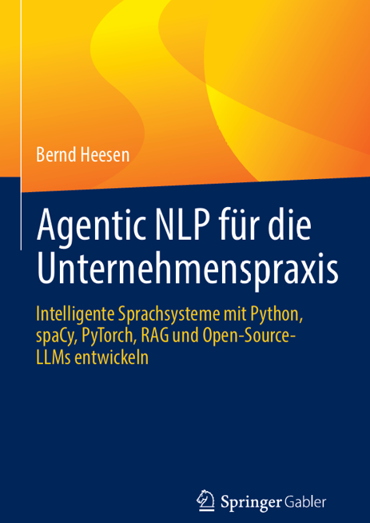

# Agentic NLP für die Unternehmenspraxis

**Intelligente Sprachsysteme mit Python, spaCy, PyTorch, RAG und
Open-Source-LLMs entwickeln**

**Bernd Heesen · Springer Gabler · ISBN 978-3-658-53643-5**

> Von den Grundlagen der natürlichen Sprachverarbeitung bis zu modernen
> Sprachmodellen und agentischen Anwendungen: Dieses Buch verbindet
> Konzepte mit nachvollziehbarer Python-Praxis.

**[Zur Buch-Webseite](https://bheesen.github.io/nlpforbusiness/)** ·
**[Buch bei Amazon](https://www.amazon.de/Agentic-NLP-Unternehmenspraxis-Sprachsysteme-Open-Source-LLMs/dp/3658536438)** ·
**[Autor](https://www.profheesen.de)**

## Inhalte

Die Begleitwebseite stellt die zentralen Themenbereiche des Buches vor:
NLP-Grundlagen, Python und Entwicklungsumgebung, Textvorverarbeitung,
spaCy, Machine Learning, PyTorch, Transformer, Open-Source-LLMs, RAG
und Agentic NLP. Das Manuskript ist fertiggestellt und liegt dem
Verlag in der finalen Fassung vor. Die Übersicht fasst zentrale
Buchinhalte zusammen.

## Begleitmaterialien

- [Installation der Entwicklungsumgebung](materialien/01-installation-entwicklungsumgebung/)
- [Coding zum Buch](materialien/02-coding-zum-buch/)
- [Coding zu Lerneinheiten der Virtuellen Hochschule Bayern](materialien/03-coding-vhb/)

Die Verzeichnisse werden nach und nach mit Materialien ergänzt.

## Über den Autor

Weitere Informationen: [www.profheesen.de](https://www.profheesen.de).
